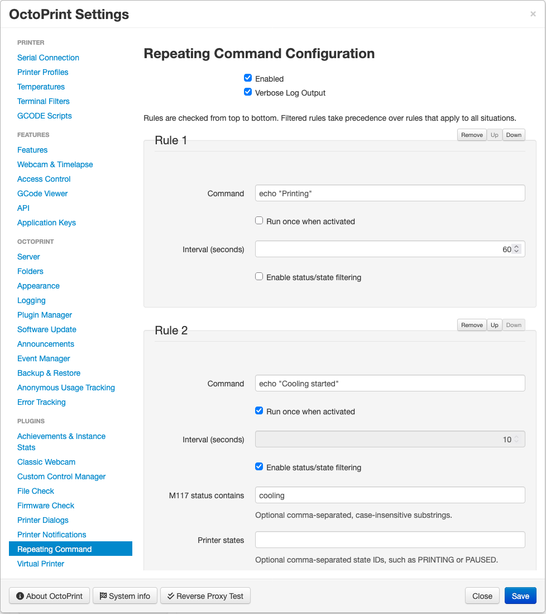

# OctoPrint Repeating Command

Run host commands repeatedly during a print, or once when a rule becomes active.
Rules can match `M117` status text or printer states, including a cooling phase
that continues after print completion.

I use it to trigger home automation that keeps an exhaust fan running while
printing.

## Installation

In OctoPrint, open **Settings → Plugin Manager → Get More → …from URL** and
install:

```text
https://github.com/aerickson/OctoPrint_RepeatingCommand/archive/refs/heads/master.zip
```

Restart OctoPrint after installation, then refresh the browser. Open
**Settings → Repeating Command** to configure the plugin.

For an editable development install, use the Python environment that runs
OctoPrint:

```sh
python -m pip install -e .
```

## Configuration

Select **Enabled**, enter a command, and choose an interval or **Run once when
activated**. Save the settings. **Verbose Log Output** records command exit codes
and output in `octoprint.log`.

The settings page below uses sample commands on a disposable local instance:



Commands run on the OctoPrint host as the user running OctoPrint. Use an absolute
path to an executable script, for example `/home/pi/bin/fan_on.sh`. Arguments and
quoted strings are supported. Shell operators such as `&&`, pipes, and redirects
are not interpreted; put those operations in a script.

### Rules and precedence

The settings page supports up to six rules. **Add Rule**, **Remove**, **Up**, and
**Down** control the list. Each rule has its own command and execution mode.

- With filtering disabled, a rule is a fallback while a print is active.
- With **Enable status/state filtering** selected, a rule matches when either its
  **M117 status contains** filter or its **Printer states** filter matches.
- Both fields accept comma-separated, case-insensitive values. Status values are
  substrings; state values are complete state IDs such as `PRINTING` or `PAUSED`.
  A filtered rule with both fields empty does not match.
- Only one rule is selected. The first matching filtered rule wins, regardless
  of where fallback rules appear. If none matches during a print, the first
  fallback wins. An invalid interval on the selected rule disables execution;
  it does not select a lower-priority rule instead.
- Outside a print, only matching filtered rules can run. A state filter can
  therefore activate a rule even when no print is running.

For example, replace these script paths with your own:

| Rule | Command | Interval | Filtering | M117 status contains | Printer states |
| --- | --- | --- | --- | --- | --- |
| Normal printing | `/home/pi/bin/10s_exhaust_fan.sh` | 60 seconds | Disabled | | |
| Cooling | `/home/pi/bin/fan_on.sh` | 10 seconds | Enabled | `cooling` | |

The cooling rule takes precedence whenever the status contains `cooling`. To
run that same rule throughout printing as well, add `PRINTING` to its **Printer
states** field: the two filters are combined with **OR**.

Existing command/interval settings and legacy alternate-profile settings are
converted to rules when the settings page loads. A legacy blank alternate
command reuses the normal command; new rules each need their own command.

### Execution and print transitions

Repeating rules execute immediately when selected, then wait the configured
interval after each execution finishes. The interval must be greater than zero.

**Run once when activated** executes once per matching activation, without
waiting for the command to finish on OctoPrint's communication or event thread.
Its saved interval is preserved but ignored. Duplicate status/state events do
not execute it again. The rule can execute again after it stops matching and
then matches again; a temporary override by another rule does not reset it.
Restarting OctoPrint also clears activation history. Zero is not a shortcut for
run-once mode.

At print start, state filters use `PRINTING` immediately. During `FINISHING` or
`CANCELLING`, only matching filtered rules can run, so a fallback does not briefly
restart before the print-end event. Unfiltered run-once rules reset at print end;
print failure or cancellation clears all run-once activation history.

A filtered cooling rule can remain active after `PrintDone`. Send a new `M117`
message that no longer matches, or leave the matching printer state, to stop it.
Both filters must stop matching if both are configured. Rules are reevaluated on
print events, state changes, and queued `M117` commands. Status matching uses the
queued message, not a temperature measurement or confirmation that the printer
has finished earlier moves or waits.

Cancelling a timer prevents future executions but does not interrupt a script
already running. Commands from successive rule activations can overlap; scripts
that control the same device should account for that.

### Quick manual check

With the printer connected, configure a filtered rule with command
`echo repeatingcommand-test`, interval `5`, and status filter `rc-test`. Leave
printer states blank, enable the plugin and verbose output, and save.

1. Send `M117 rc-test` from OctoPrint's Terminal. Check `octoprint.log` for repeated
   successful command results.
2. Send `M117 idle`. Repetition should stop.
3. Select **Run once when activated**, save, then close and reopen settings.
   Confirm the option persists and the saved interval is still `5`.
4. Send `M117 rc-test` several times. Expect one execution. Send `M117 idle`, then
   `M117 rc-test`, and expect one more.
5. Send `M117 idle` to finish.

## Testing

GitHub Actions runs the unit tests and syntax checks on Python 3.9, 3.11, and
3.13, plus the Firefox browser smoke test against a disposable OctoPrint instance
on Ubuntu. Checks run for pull requests and pushes to `master`; the **Tests**
workflow also supports manual runs from the Actions tab. Failed browser runs
upload available diagnostics as a seven-day artifact.

Install [uv](https://docs.astral.sh/uv/) and Node.js, then run the unit suites and
syntax checks from the repository root:

```sh
uv sync --locked
./run-tests.sh
```

The browser smoke test is a separate command. To run individual unit suites:

```sh
uv run pytest -q
node test/repeatingcommand_viewmodel_smoke.js
```

For an existing OctoPrint virtual environment, install the test tools without
replacing that environment:

```sh
source ~/OctoPrint/bin/activate
python -m pip install -r requirements-test.txt
python -m pytest -q
```

The backend tests use lightweight OctoPrint fakes and do not require a running
OctoPrint server or a connected printer.

### Browser integration smoke test

The standalone browser test launches a disposable localhost OctoPrint instance
and exercises the installed wheel's settings page with Playwright-managed
Firefox. It uses `uv` to create a temporary Python 3.11 environment, install the
latest OctoPrint, build/install the current wheel, and install the pinned
Playwright version from the `playwright-testing` dependency group.

On Linux, first install Firefox's system dependencies; this may request sudo:

```sh
uv run --locked --only-group playwright-testing python -m playwright install-deps firefox
```

Run the browser test with:

```sh
test/browser_smoke.sh
```

The driver downloads Firefox into its temporary runtime. It runs headless by
default and supports `--headed`, `--verbose`, and `--preserve-basedir`. The default
run resets `.tmp/octoprint-smoke/`; use `--preserve-basedir` when investigating
stateful behavior. Browser failures leave available logs, a screenshot, and a
Playwright trace under `.tmp/octoprint-smoke-artifacts/`.

## Acknowledgements

Loosely based on [OctoPrint_FreeMobile-Notifier](https://github.com/Pinaute/OctoPrint_FreeMobile-Notifier).

## License

Licensed under the terms of the [AGPLv3](https://www.gnu.org/licenses/agpl-3.0.html).
